<div align="center">

# Orelia

### From diagnosis to being seen.

Orelia helps adults with a rare disease get seen. It turns a diagnosis into appointments:
it finds the specialists, studies, advocacy groups and aid that fit, then runs the outreach
with one persistent agent per resource, and a person approves every message before it leaves.

[](https://orelia-health.vercel.app)


</div>

## The problem

Getting a rare disease diagnosed is only the first wall. Getting in front of someone who can treat it is the second.

| Figure | Source |
|---|---|
| **95%** of rare diseases have no FDA-approved treatment | [Global Genes, Rare Disease Facts](https://globalgenes.org/rare-disease-facts/) |
| **10,000+** rare diseases exist, and **25-30 million Americans** live with one | [Global Genes](https://globalgenes.org/rare-disease-facts/), [NIH NHGRI](https://www.genome.gov/faq/rare-diseases) |
| **4.7 years** from first symptoms to a confirmed diagnosis (Europe) | [EURORDIS Rare Barometer](https://www.eurordis.org/survey-reveals-lengthy-diagnostic-delays) |
| **1 in 4** patients saw 8 or more health professionals before diagnosis | [EURORDIS Rare Barometer](https://www.eurordis.org/survey-reveals-lengthy-diagnostic-delays) |

Expert finders tell you who the expert is. Orelia gets you seen: it does the research, writes the outreach,
asks first, and keeps following up after the patient closes the laptop.

## How it works

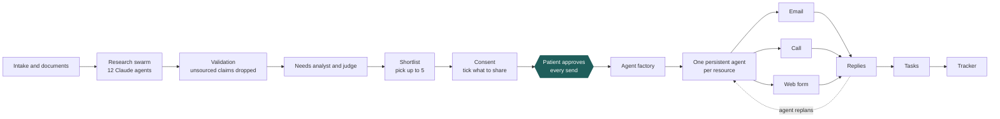

1. **Intake.** Paste a report or clinic letter. Orelia copies out only the details needed to search, and the patient confirms them.
2. **Research swarm.** Twelve agents run in parallel over PubMed, ClinicalTrials.gov, NPPES, NCI centers and Exa: literature, trials, specialist identity, centers, advocacy, aid, research networks, disease funds, second opinions, contact finder, network and logistics.
3. **Validation.** A deterministic verifier drops any claim without a source link and merges duplicates.
4. **Needs analyst and judge.** The analyst lists what this condition needs; the final judge keeps, downgrades or drops each candidate with a reason that cites its own sources.
5. **Shortlist, consent, plan.** The patient picks up to five resources and ticks which details each may see. Orelia builds a contact plan per resource (email, call, web form, or a sequence of them).
6. **Approval, then agents.** Approving the plan spawns one persistent agent per resource. Every outbound message is a draft until the patient approves it.
7. **Replies become tasks.** Replies, call transcripts and form confirmations are classified into tasks (send records, take a referral) and land in the tracker.

## Architecture

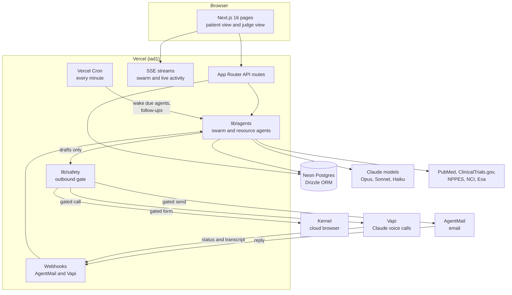

- **Models:** every language model is Claude. Roles are mapped in [`config/models.ts`](config/models.ts); overrides may only pick another `claude-*` id. Phone calls run on Claude inside Vapi.
- **Persistence:** the browser only reads. A cron tick every minute (`vercel.ts`) wakes due agents and follow-ups, and every step leases its rows (`FOR UPDATE SKIP LOCKED`) so overlapping ticks never send twice.
- **Webhooks:** AgentMail replies and Vapi call status and transcripts are authenticated, deduplicated and fed to the same inbox classifier.

## The persistent agent lifecycle

Each selected resource gets its own agent. Code decides which actions are allowed; the model only chooses among them.

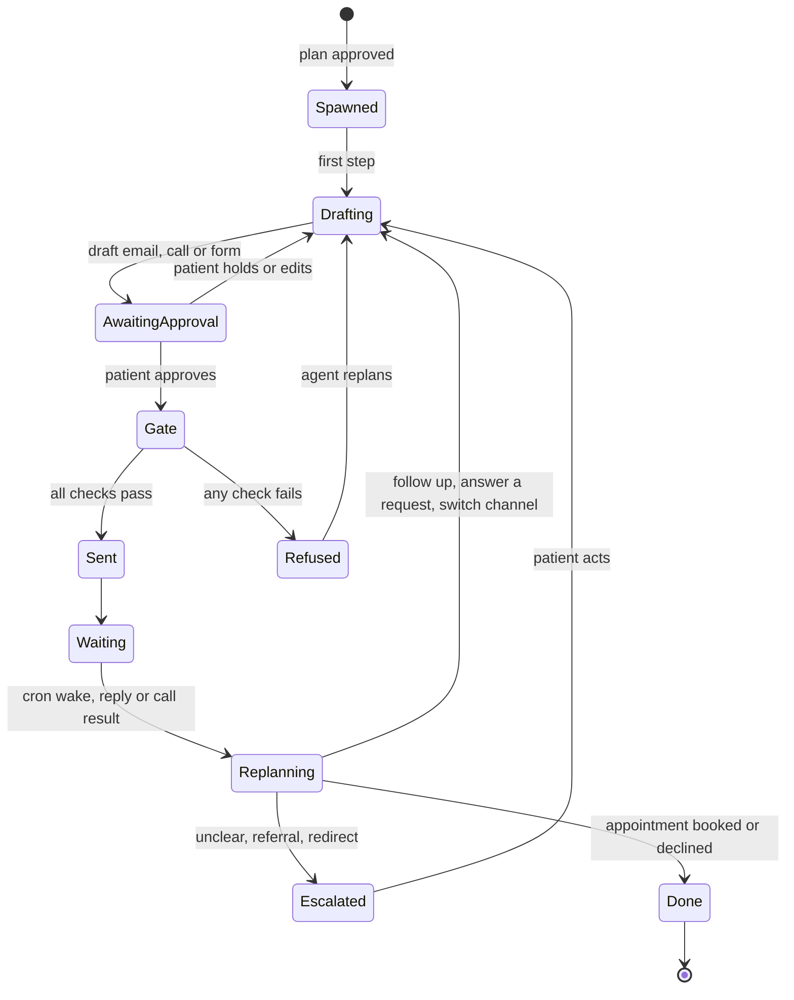

The patient can talk to any agent from the tracker ("Chat with ..."). A message becomes one validated instruction: a question (answered only from that agent's own memory and thread), a note, a constraint such as "email only", or a request for a new draft. A new action is an unapproved draft with its own approve card, so the gate still decides.

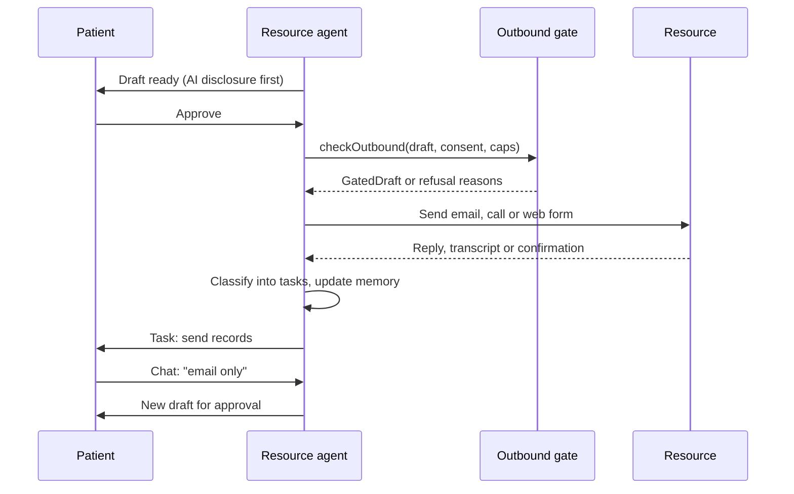

## Safety by design

Every item below is enforced in code, not by prompt.

- **Approval before any send.** A draft without `approved_at` cannot pass the outbound gate. Channels accept only the gate's unforgeable `GatedDraft`, never a raw draft ([`lib/safety`](lib/safety/README.md)).
- **Allowlist.** Production stays allowlisted (`OUTBOUND_ALLOWLIST`) unless real sending is explicitly enabled. In demo mode every channel is routed to Orelia's own test destinations.
- **Ticked fields only.** A message may contain only the details the patient ticked for that contact; unticked case values are detected and refused.
- **AI disclosure first.** Emails carry the disclosure, and a call opens with it spoken in full before anything else.
- **At most 5 active contacts**, and a follow-up cadence of business days 3 and 7 with at most two follow-ups.
- **No medical advice.** A phrase filter blocks advice in drafts, subjects and chat answers; emergencies get a fixed 911 message.
- **Untrusted content is neutralized.** Web pages, replies and transcripts are treated as data, never as instructions.
- **Calls are scripted.** The assistant gets the approved script only, can hang up, leaves no patient details on voicemail, and live control of the call is off.
- **Web forms are allowlisted.** The Kernel browser only opens hosts on `OUTBOUND_WEB_ALLOWLIST`, and a filled form waits for approval before it is submitted.
- **Synthetic data only** in fixtures, demos and tests.

## Screenshots

Captured from production in the judge view (one patient-view shot for contrast) with a synthetic vascular Ehlers-Danlos patient in Houston, TX.

<table>
  <tr>
    <td width="50%">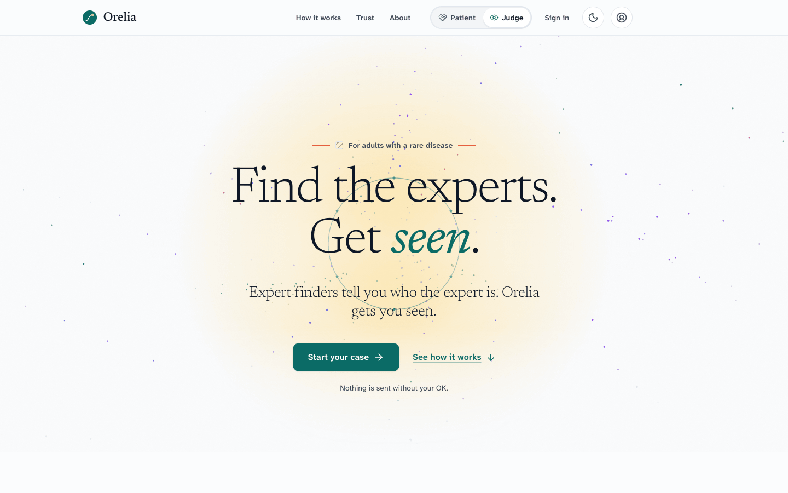<br><sub><b>Landing.</b> "Find the experts. Get seen."</sub></td>
    <td width="50%">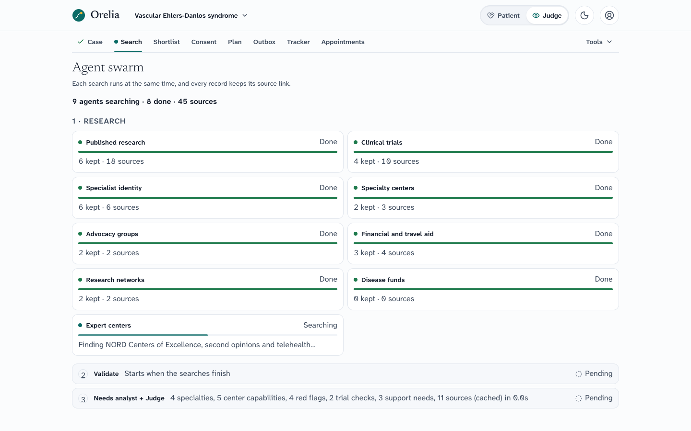<br><sub><b>Agent swarm.</b> Twelve searches in parallel, each with a source count, then validate and judge.</sub></td>
  </tr>
  <tr>
    <td width="50%">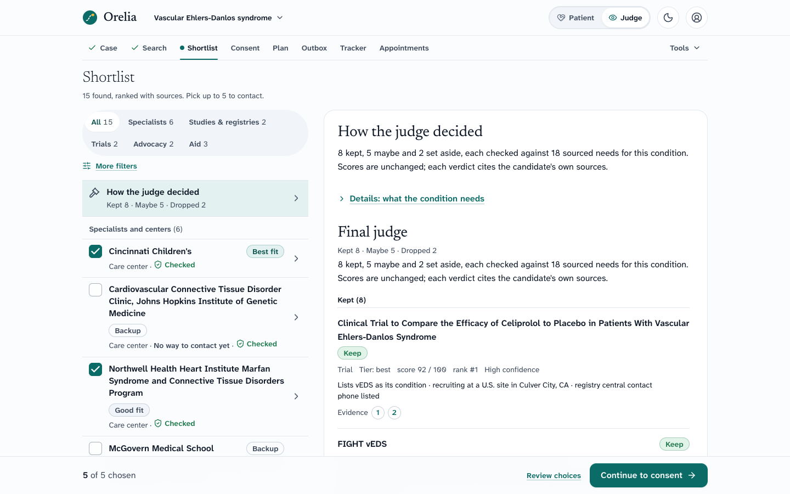<br><sub><b>Shortlist.</b> Ranked candidates beside "How the judge decided", with evidence links.</sub></td>
    <td width="50%">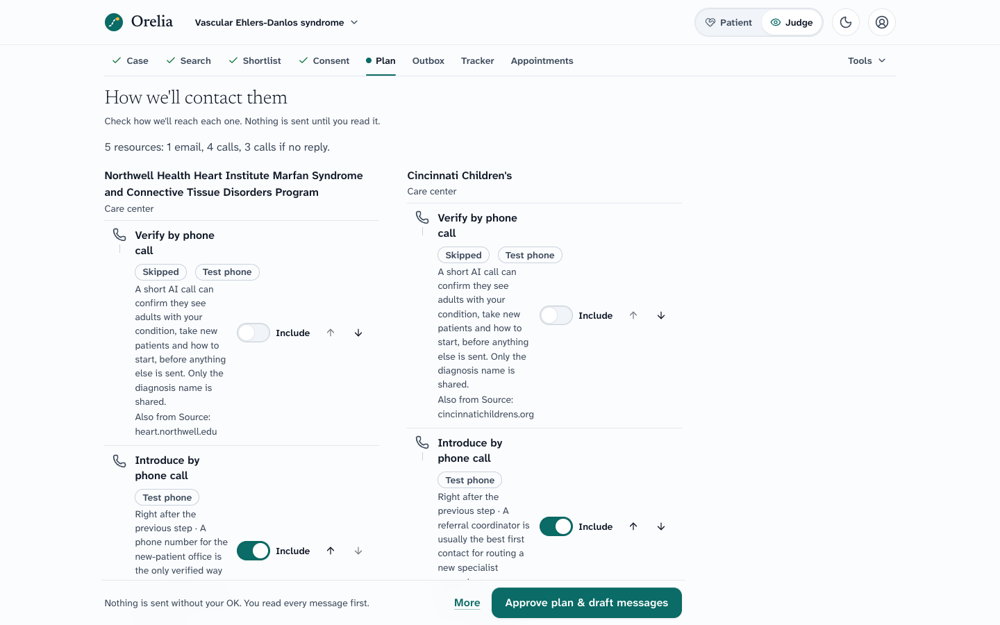<br><sub><b>Contact plan.</b> Channel, order and a reason for every step; nothing is sent until approved.</sub></td>
  </tr>
  <tr>
    <td width="50%">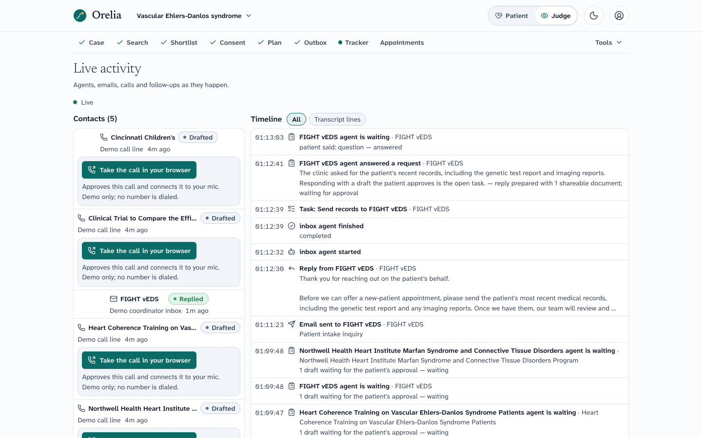<br><sub><b>Live console.</b> A reply arrives, the inbox agent turns it into a task, the lane flips to Replied.</sub></td>
    <td width="50%">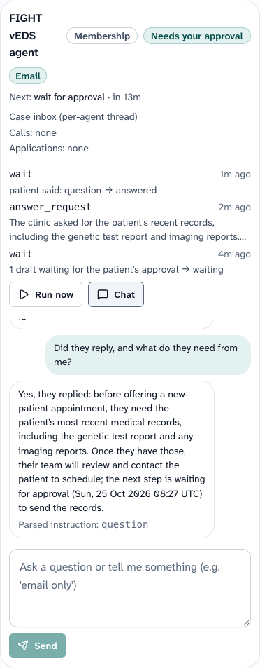<br><sub><b>Tracker and agent chat.</b> One persistent agent per resource, with its event log and a chat.</sub></td>
  </tr>
  <tr>
    <td width="50%">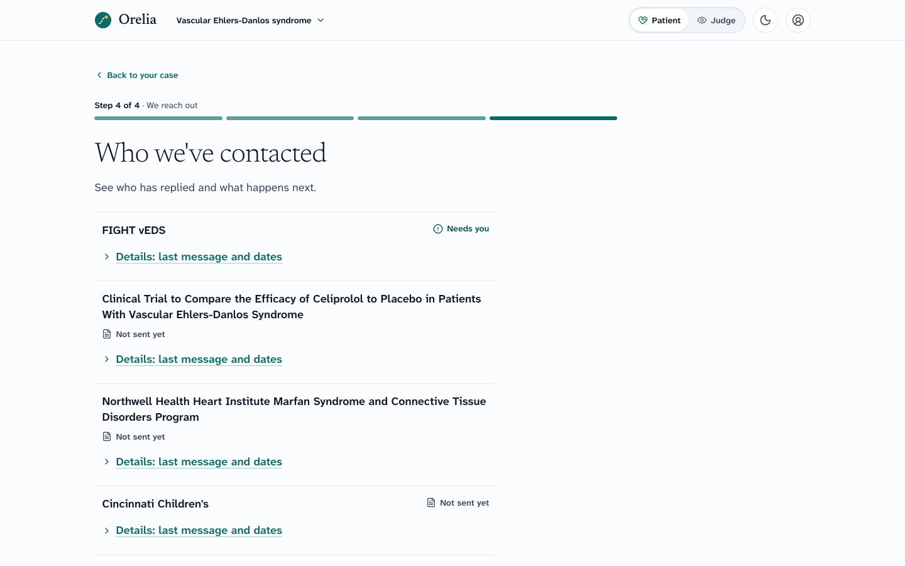<br><sub><b>Patient view.</b> The same case, simplified: who was contacted and what happens next.</sub></td>
    <td width="50%"></td>
  </tr>
</table>

## Tech stack

| Layer | Choice |
|---|---|
| App | Next.js 16 (App Router), React 19, TypeScript 6, Tailwind v4, Radix UI |
| Data | Neon Postgres, Drizzle ORM, pgvector document store per case |
| Models | Claude (Opus, Sonnet, Haiku) via the Anthropic SDK |
| Sources | PubMed, ClinicalTrials.gov, NPPES, NCI cancer centers, Exa |
| Email | AgentMail |
| Voice | Vapi with a Claude assistant (AgentCall remains as a fallback) |
| Web forms | Kernel cloud browser driven with Playwright |
| Platform | Vercel (Cron, headers and CSP in `vercel.ts`), Inngest workflows (optional) |
| Tests | Vitest |

## Quick start

Requires Node 22 or newer.

```bash
npm ci
cp .env.example .env.local
npm run dev
```

### Run the whole flow offline

No keys needed. The offline demo replays recorded fixtures through intake, research, validation, ranking and the judge:

```bash
WAYFINDER_OFFLINE=1 npx tsx scripts/demo-offline.ts --all
```

The variable keeps the old repository name on purpose. `--case <slug>` runs one case and `--top <n>` limits the printed shortlist.

### Tests

```bash
npm run typecheck && npm run lint && npm test && npm run build
```

### Environment

Names only; copy `.env.example` and fill in values locally. Secrets live in `.env.local` and Vercel, never in the repo.

| Group | Variables |
|---|---|
| Database and sessions | `DATABASE_URL`, `WAYFINDER_SESSION_SECRET`, `WAYFINDER_SHARE_SECRET`, `WAYFINDER_TOKEN_KEY`, `WAYFINDER_APP_ORIGIN`, `WAYFINDER_APP_BASE_URL` |
| Models and research | `ANTHROPIC_API_KEY`, `NEON_AI_GATEWAY_BASE_URL`, `NEON_AI_GATEWAY_TOKEN`, `EXA_API_KEY`, `NCBI_API_KEY`, `WAYFINDER_MODEL_*`, `WAYFINDER_CASE_BUDGET_USD` |
| Email | `AGENTMAIL_API_KEY`, `AGENTMAIL_WEBHOOK_SECRET`, `AGENTMAIL_SENDER_INBOX_ID`, `AGENTMAIL_INBOX_DOMAIN`, `WAYFINDER_NOTIFY_INBOX_ID` |
| Voice | `VOICE_PROVIDER`, `VAPI_API_KEY`, `VAPI_PHONE_NUMBER_ID`, `VAPI_WEBHOOK_SECRET`, `VAPI_PUBLIC_KEY`, `VAPI_SERVER_URL`, `AGENTCALL_API_KEY`, `AGENTCALL_WEBHOOK_SECRET`, `AGENTCALL_FROM_NUMBER_ID` |
| Web forms | `KERNEL_API_KEY`, `OUTBOUND_WEB_ALLOWLIST` |
| Outbound safety | `OUTBOUND_ALLOWLIST`, `OUTBOUND_ALLOW_REAL` |
| Persistence | `CRON_SECRET`, `INNGEST_EVENT_KEY`, `INNGEST_SIGNING_KEY`, `AGENT_LEASE_MS` |
| Demo and offline | `WAYFINDER_OFFLINE`, `NEXT_PUBLIC_WAYFINDER_OFFLINE`, `WAYFINDER_DEMO`, `WAYFINDER_DEMO_COORDINATORS`, `DEMO_COORDINATOR_INBOXES`, `DEMO_REPLY_ALLOWLIST`, `WAYFINDER_SIM_TIME_SCALE` |
| Accounts, files, calendar | `NEON_AUTH_BASE_URL`, `NEON_AUTH_COOKIE_SECRET`, `BLOB_READ_WRITE_TOKEN`, `GOOGLE_CLIENT_ID`, `GOOGLE_CLIENT_SECRET` |

More: [live demo script](docs/DEMO-LIVE.md), [voice provider](docs/VOICE-PROVIDER.md), [design system](docs/DESIGN-v2.md), [deployment](docs/DEPLOY.md).

## Project structure

```text
app/                  Next.js routes: landing, intake, cases/[id]/{swarm,shortlist,consent,plan,outbox,live,tracker}, api/
components/           UI by surface: swarm, shortlist, plan, live console, agents, shell
config/               Model roles, ranking weights
db/                   Drizzle schema and client
lib/agents/           Research swarm, verifier, curator, needs analyst, judge, resource-agent factory
lib/channels/         AgentMail, Vapi, AgentCall and Kernel adapters, plus mocks
lib/safety/           Outbound gate, allowlists, caps, disclosure, no-medical-advice filter
lib/workflows/        Cron tick, follow-up sweep, connection state machine
lib/demo-live/        One-click synthetic demo case and scripted coordinator replies
fixtures/             Synthetic reports and recorded model output
scripts/              Offline demo, live demo driver, webhook registration
tests/                Vitest suites
docs/                 Demo script, design system, voice provider, deployment
```

---

<sub>Synthetic data only; Orelia never gives medical advice. In an emergency call 911.</sub>
